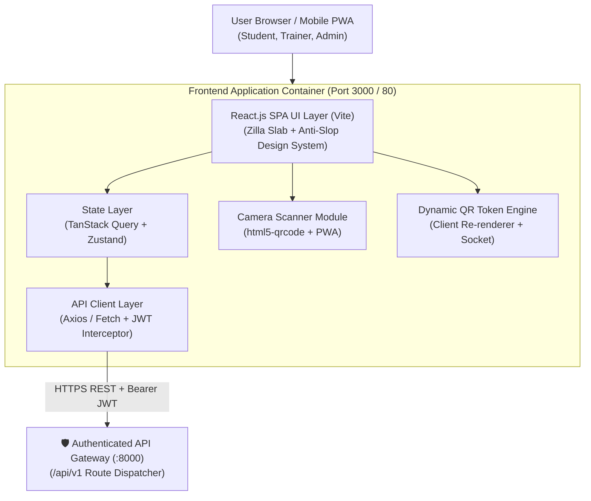

# GymSlot — Frontend Design & Deployment Documentation

Welcome to the comprehensive frontend design and engineering documentation for **GymSlot** — the official gym slot allocation, digital pass, attendance tracking, and sports management portal for SRM University-AP.

This documentation suite translates all business logic from [`REQUIREMENTS.md`](../REQUIREMENTS.md), [`system-architecture.md`](../system-architecture.md), [`03-database.md`](../03-database.md), and [`README.md`](../README.md) into an actionable, deploy-friendly, and art-directed frontend design system.

---

## 📚 Documentation Index

| Document | Title | Purpose & Scope |
| :--- | :--- | :--- |
| **[Frontend Implementation Plan](frontend-implementation-plan.md)** | **Step-by-Step Execution Plan** | **13-phase roadmap with atomic deliverables and user verification checkpoints for reviewing work after every single step.** |
| **[01. Frontend Architecture](01-frontend-architecture.md)** | Core Architecture & Stack | Pure React.js (Vite + React 18+ SPA), folder structure, state management (TanStack Query + Zustand), API Gateway integration (`/api/v1`), Google OAuth 2.0 / JWT session lifecycle, and security controls. |
| **[02. Design System](02-design-system.md)** | Anti-Slop Visual Identity | Visual tokens, collegiate athletic palette (`three-stones` + forest green `#2e4a3e`), typography (`Zilla Slab` + tabular sans), tactile stationery surfaces (`page-is-the-object`), `data-ui` rules, and WCAG AAA accessibility. |
| **[03. Screens & Workflows](03-screens-and-workflows.md)** | Complete UX Specifications | Screen-by-screen UX specifications across all 4 user roles: Student Portal (Digital Card, QR rotation, transfers, waitlists), Trainer Scanner (Turnstile camera, photo overlay, manual fallback), Sports Admin Dashboard (facilities, slots, attendance audit, absence reclamation, complaints, Excel imports), and Super Admin. |
| **[04. Deployment & DevOps](04-deployment-and-devops.md)** | Deploy-Friendly Production Guide | Production containerization (multi-stage Dockerfile, Nginx alpine runner), Docker Compose service definition, environment variables, camera permissions policy for QR scanning, PWA offline card setup, and CI/CD GitHub Actions pipeline. |

---

## 🎯 Architecture Summary at a Glance

---

## 👥 User Roles & Portals Matrix

| Role | Primary Device | Key Capabilities | Primary Screens |
| :--- | :--- | :--- | :--- |
| **`STUDENT`** | Mobile / Desktop | Google OAuth login, profile onboarding, dynamic QR digital gym pass, slot browser, FCFS waitlist tracking, atomic slot change request, attendance history, absence risk monitor, complaint tickets. | `/student/dashboard` `/student/card` `/student/slots` `/student/transfers` `/student/attendance` `/student/complaints` |
| **`TRAINER`** | Mobile / Tablet | Turnstile camera QR scanner, instant photo & AP verification, duplicate check-in guard, manual AP fallback with audit reason, session live roster. | `/trainer/scanner` `/trainer/manual-checkin` `/trainer/roster` |
| **`ADMIN`** | Desktop | Facility & slot setup, recurrence rules, registration windows, waitlist promotions, atomic transfers, attendance correction modal, absence policy engine, complaints triage, Excel bulk imports, CSV analytics export. | `/admin/dashboard` `/admin/facilities` `/admin/registrations` `/admin/transfers` `/admin/attendance` `/admin/absence` `/admin/complaints` `/admin/imports` `/admin/reports` |
| **`SUPER_ADMIN`** | Desktop | Staff account provisioning, role grants (`TRAINER`, `ADMIN`), college domain rules (`@srmap.edu.in`), audit trail inspection. | `/admin/staff` `/admin/settings` `/admin/audit-logs` |

---

## 🚀 Quick Links for Developers
- To understand directory conventions and technical scaffolding, see **[01. Frontend Architecture](01-frontend-architecture.md)**.
- To inspect CSS tokens, styling rules, and reusable component blueprints, see **[02. Design System](02-design-system.md)**.
- To implement individual screens, user interactions, and error states, see **[03. Screens & Workflows](03-screens-and-workflows.md)**.
- To containerize and deploy the application via Docker or Kubernetes, see **[04. Deployment & DevOps](04-deployment-and-devops.md)**.
