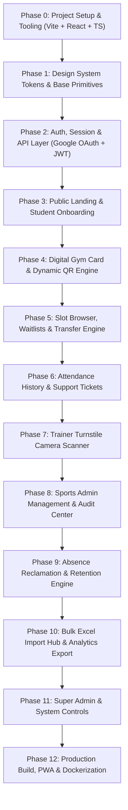

# GymSlot — Frontend Implementation Plan (React.js SPA)

**Architecture:** Pure React.js (React 18+ / Vite / TypeScript) — *No Next.js*  
**Design System:** `page-is-the-object` Tactile University Stationery (`Zilla Slab` + Collegiate Green `#2e4a3e`)  
**Target Delivery:** Progressive Web App (PWA) + Container-Ready SPA (Nginx)  
**Location:** `frontend/docs/frontend-implementation-plan.md`

---

## 📋 Executive Overview & Workflow Policy

This plan lays out the complete, step-by-step roadmap to implement the entire **GymSlot** frontend in **pure React.js**. Every phase is broken down into atomic steps with explicit **Verification & Review Checkpoints** so the user can test, inspect, and approve all work at each milestone before proceeding to the next.

---

## 🚀 Phase 0: Project Scaffolding & Tooling (React.js + Vite)

### Step 0.1 — Initialize Vite React + TypeScript App
- **Action:** Scaffold clean React 18+ app using Vite in `frontend/` (or update existing directory structure).
- **Core Dependencies:**
  - `react`, `react-dom`, `react-router-dom` (v6+)
  - `typescript`, `@types/react`, `@types/react-dom`
  - `@tanstack/react-query`, `zustand`
  - `axios`, `zod`, `react-hook-form`, `@hookform/resolvers`
  - `html5-qrcode`, `qrcode.react`
  - `lucide-react` (curated geometric glyphs)
- **Files to Create:**
  - `frontend/package.json`
  - `frontend/vite.config.ts` (with path alias `@/*` -> `./src/*` and dev proxy to `:8000`)
  - `frontend/tsconfig.json`
  - `frontend/index.html` (with Google Font `Zilla Slab` 400/500/600 preloaded)
- 🔍 **User Verification Checkpoint 0.1:**
  - Run `npm run dev` in `frontend/`.
  - Open `http://localhost:5173` in browser.
  - Verify zero console errors, Vite HMR active, and TypeScript strict mode passes (`npm run build`).

---

## 🎨 Phase 1: Design System Tokens & Base Primitives

### Step 1.1 — CSS Token System & Typography Engine
- **Action:** Implement global token foundation from [`02-design-system.md`](02-design-system.md) in `src/styles/tokens.css` and `src/styles/globals.css`.
- **Tokens Included:**
  - Warm stone ground (`--bg: #eeecea`), ledger surface (`--surface: #e4e1dd`), paper card (`--card-paper: #e8e5e0`).
  - SRM-AP collegiate athletic forest green (`--accent: #2e4a3e`).
  - Status accents (`--status-present`, `--status-absent`, `--status-late`, `--status-waitlist`).
  - Fluid typography clamp scale (`--step-small` to `--step-display`) in `Zilla Slab`.
  - Tabular figure utility (`.nums` / `font-variant-numeric: tabular-nums`).
- **Files to Create:**
  - `src/styles/tokens.css`
  - `src/styles/reset.css`
  - `src/styles/globals.css`

### Step 1.2 — Atomic Component Primitives
- **Action:** Build reusable anti-slop atomic components without generic borders or floating shadows.
- **Components to Build:**
  - `Button` (Primary athletic green, secondary paper tint, disabled/loading state).
  - `Input` / `Select` / `Textarea` (Tactile focus ring, error message, high-contrast text).
  - `BadgePill` (Square-cornered status tag for `PRESENT`, `ABSENT`, `ACTIVE`, `WAITLISTED`).
  - `FolderTabs` (Physical filing tab strip with active sheet coupling).
  - `Modal` (`data-ui` scoped dialog with backdrop scrim and escape key dismissal).
  - `PerforatedSlip` (Container with zigzag tear-away edge for timetables and tickets).
- **Files to Create:**
  - `src/components/ui/Button.tsx`
  - `src/components/ui/Input.tsx`
  - `src/components/ui/Badge.tsx`
  - `src/components/ui/FolderTabs.tsx`
  - `src/components/ui/Modal.tsx`
  - `src/components/ui/PerforatedSlip.tsx`
- 🔍 **User Verification Checkpoint 1:**
  - Review component story/test page rendering buttons, badges, tabs, and perforated slips.
  - Test keyboard focus rings (`Tab` key navigates with 3px solid `--accent` indicator).
  - Check WCAG contrast with DevTools (all text passes 7:1+ contrast).

---

## 🔐 Phase 2: Auth, Session & API Gateway Integration

### Step 2.1 — API Client & Axios Interceptor
- **Action:** Configure central HTTP client targeting the `/api/v1` FastAPI Gateway with automatic JWT token refresh.
- **Capabilities:**
  - Bearer token injection on authenticated endpoints.
  - Automatic 401 interception: triggers `/api/v1/auth/refresh` or clean logout redirect.
  - Standardized error formatting (Pydantic validation error parsing).
- **Files to Create:**
  - `src/lib/api-client.ts`
  - `src/lib/endpoints.ts`
  - `src/types/api.ts`

### Step 2.2 — Google OAuth 2.0 & Session Store (Zustand)
- **Action:** Implement authentication store and OAuth callback handler strictly validating `@srmap.edu.in`.
- **State Properties:**
  - `user`: `{ id, email, full_name, role, ap_number, is_active }`
  - `isAuthenticated`: `boolean`
  - `token`: `string | null`
  - `login()`, `logout()`, `refreshUser()`
- **Files to Create:**
  - `src/stores/useAuthStore.ts`
  - `src/pages/auth/Login.tsx` (with "Continue with SRM-AP Google Account" button)
  - `src/pages/auth/AuthCallback.tsx` (exchanges Google code for backend JWT)
  - `src/components/auth/ProtectedRoute.tsx` (Role-based route guard for `STUDENT`, `TRAINER`, `ADMIN`, `SUPER_ADMIN`)
- 🔍 **User Verification Checkpoint 2:**
  - Test login flow with mock/real Google token.
  - Attempt accessing `/admin` as a `STUDENT` -> Verify immediate redirect to 403 Slate.
  - Test session expiration and automatic token refresh.

---

## 🏛️ Phase 3: Public Landing Page & Student Onboarding

### Step 3.1 — Public Landing Page (React Version)
- **Action:** Port the audited, anti-slop landing page from `frontend/web/` into a modular React component tree.
- **Sections Included:**
  - University Masthead with Google OAuth login trigger.
  - Hero Tabbed Folder with Facility previews (C. V. Raman, Ganga, Krishna, Narmada).
  - Interactive Simulator component (`#simulator`).
  - Campus Access Itinerary slip.
  - Four Foundational Safeguards.
  - Official Session Timetable.
  - FAQ Accordion & Reply Card CTA.
  - Institutional Footer with Creative Commons image credits.
- **Files to Create:**
  - `src/pages/public/LandingPage.tsx`
  - `src/components/landing/HeroFolder.tsx`
  - `src/components/landing/PassSimulator.tsx`
  - `src/components/landing/ItinerarySlip.tsx`
  - `src/components/landing/TimetableCard.tsx`

### Step 3.2 — Student Profile Onboarding & Photo Upload
- **Action:** Build onboarding screen for newly provisioned students without approved photos.
- **Form Controls:**
  - Read-only student details (AP Number, Name, Department).
  - Photo upload dropzone with image preview and aspect-ratio crop guide.
  - Real-time client validation (JPEG/PNG only, max 5MB).
  - Submission to `POST /api/v1/students/photo/upload`.
- **Files to Create:**
  - `src/pages/student/Onboarding.tsx`
  - `src/components/student/PhotoUploadDropzone.tsx`
- 🔍 **User Verification Checkpoint 3:**
  - Open landing page at `http://localhost:5173/` -> Test facility tabs and live pass rotation.
  - Simulate first-time login -> Test photo upload drag-and-drop and validation errors.

---

## 🪪 Phase 4: Digital Gym Card & Dynamic QR Engine

### Step 4.1 — Digital Gym Card Object (`data-ui`)
- **Action:** Build the tactile digital gym card component with high-resolution portrait photo and official university credentials.
- **Key Details:**
  - Pre-signed S3 photo rendering with fallback silhouette.
  - Student AP Number, Full Name, Assigned Gym, Slot Batch.
  - Green `TURNSTILE VALID` badge.
  - Download pass button (generates offline image/pass).

### Step 4.2 — Rotating 30-Second Opaque QR Engine
- **Action:** Create custom hook and component that auto-rotates the encrypted session token `#tok-srm-...` every 30 seconds.
- **Key Capabilities:**
  - Fetches token from `GET /api/v1/students/gym-card/token`.
  - SVG/Canvas QR rendering (`qrcode.react`) with zero readable PII in payload.
  - Circular countdown timer bar showing seconds remaining (30s -> 0s).
  - Seamless background rotation without card flickering.
- **Files to Create:**
  - `src/components/gym-card/DigitalGymCard.tsx`
  - `src/hooks/useQRToken.ts`
  - `src/pages/student/GymCardPage.tsx`
- 🔍 **User Verification Checkpoint 4:**
  - Navigate to `/student/card`.
  - Watch QR token countdown bar reach 0s -> Confirm token string updates and QR redraws without UI stutter.
  - Inspect QR contents using phone camera -> Verify payload is an opaque hash with zero plain-text PII.

---

## 🏋️ Phase 5: Slot Browser, Waitlists & Transfer Engine

### Step 5.1 — Facility Slot Browser & Live Capacity Gauges
- **Action:** Build facility browser across all 4 SRM-AP gym complexes with real-time occupancy.
- **Controls & States:**
  - Tabs: `C. V. Raman`, `Ganga`, `Krishna`, `Narmada`.
  - Slot cards (06:00 to 20:00 batches) with live progress bar: e.g. `106 / 120 Allocated`.
  - Direct Application button (active when capacity > 0 and student has no active allocation).
  - `Join FCFS Waitlist` button (active when capacity is full; displays current queue position, e.g. *8 in line*).
- **Files to Create:**
  - `src/pages/student/SlotBrowserPage.tsx`
  - `src/components/slots/SlotCard.tsx`
  - `src/components/slots/CapacityGauge.tsx`

### Step 5.2 — Protected Slot Transfer Request Engine
- **Action:** Build the transfer request workflow allowing students with active slots to apply for a swap without risking their current seat.
- **Key Features:**
  - Side-by-side ledger comparing **Current Slot** vs **Target Slot**.
  - Protected Transfer Guarantee banner: *"Your current slot remains active until transfer is approved."*
  - Reason selector dropdown (`Class Clash`, `Lab Schedule`, `Hostel Move`, `Fitness Goal`).
  - Optimistic submission handling with TanStack Query.
- **Files to Create:**
  - `src/pages/student/SlotTransferPage.tsx`
  - `src/components/slots/TransferComparisonLedger.tsx`
- 🔍 **User Verification Checkpoint 5:**
  - Test switching facilities and applying for open vs full slots.
  - Submit a transfer request -> Verify target slot displays `TRANSFER PENDING` and current slot remains intact.

---

## 📅 Phase 6: Attendance History, Absence Risk & Complaints

### Step 6.1 — Student Attendance Ledger & Absence Barometer
- **Action:** Build historical calendar and ledger view with absence risk calculation.
- **Features:**
  - Weekly streak badge (`4/5 sessions`).
  - **Absence Risk Barometer:**
    - Green (0–1 absence): Good standing.
    - Amber (2 absences): Warning banner.
    - Red striped (3 absences): Critical alert (*1 absence away from automated reclamation*).
  - Attendance table with status pills (`PRESENT`, `ABSENT`, `LATE`, `EXCUSED`).
  - Exemption reason popover.
- **Files to Create:**
  - `src/pages/student/AttendancePage.tsx`
  - `src/components/attendance/AbsenceBarometer.tsx`
  - `src/components/attendance/AttendanceTable.tsx`

### Step 6.2 — Student Support & Complaints Desk
- **Action:** Build ticketing interface for reporting scanner clashing, wrong absences, or facility issues.
- **Features:**
  - Ticket submission modal with category selector.
  - Active tickets list with status pills (`OPEN`, `IN_PROGRESS`, `RESOLVED`).
  - Chronological message thread with Sports Staff replies.
- **Files to Create:**
  - `src/pages/student/ComplaintsPage.tsx`
  - `src/components/complaints/ComplaintModal.tsx`
  - `src/components/complaints/TicketThread.tsx`
- 🔍 **User Verification Checkpoint 6:**
  - Inspect attendance ledger and verify absence meter shifts states based on simulated absence count.
  - Submit a test support ticket and verify conversation thread renders correctly.

---

## 📷 Phase 7: Trainer Turnstile Scanner App

### Step 7.1 — Camera Scanner Viewport (`html5-qrcode`)
- **Action:** Implement tablet/mobile turnstile scanner with camera device switching and audio/haptic feedback.
- **Capabilities:**
  - Front/rear camera selector + flashlight toggle where hardware permits.
  - Continuous 15fps scan loop.
  - Sends scanned hash to `POST /api/v1/attendance/scan`.
- **Files to Create:**
  - `src/pages/trainer/TurnstileScannerPage.tsx`
  - `src/components/scanner/CameraViewport.tsx`
  - `src/hooks/useTurnstileScanner.ts`

### Step 7.2 — Multi-Point Verification Overlay (<100ms)
- **Action:** Build rapid identity confirmation slate displayed upon successful token read.
- **Overlay Elements:**
  - Verified student portrait photo.
  - Full Name & AP Number.
  - Scheduled batch confirmation: **`C. V. Raman · 17:45 – 18:45`**.
  - One-tap action buttons: `[CONFIRM ENTRY]` (chime sounds) vs `[FLAG / REJECT]`.
- **Exception Guards:**
  - Red buzzer on duplicate scan (*"Already Checked In at 17:48"*).
  - Amber warning on time mismatch (*"Scheduled for 19:00 Batch"*).

### Step 7.3 — Manual AP Fallback & Live Batch Roster
- **Action:** Manual search by AP number for dead batteries/broken screens, plus live batch attendee list.
- **Files to Create:**
  - `src/pages/trainer/ManualCheckInPage.tsx`
  - `src/pages/trainer/LiveRosterPage.tsx`
- 🔍 **User Verification Checkpoint 7:**
  - Open `/trainer/scanner` on phone or webcam -> Scan QR generated in Phase 4.
  - Confirm instant verification card pops up with student photo.
  - Test scanning same QR twice -> Verify duplicate alert triggers.

---

## 📊 Phase 8: Sports Administrator Management & Audit Center

### Step 8.1 — Sports Admin Executive Dashboard
- **Action:** Build real-time analytics command center.
- **KPI Widgets:**
  - Real-time campus facility occupancy (%).
  - Today's completed check-ins vs total expected.
  - High-risk students counter (3 absences).
  - Pending queues: Transfer requests count & Photo review count.
- **Files to Create:**
  - `src/pages/admin/AdminDashboard.tsx`
  - `src/components/admin/MetricCard.tsx`
  - `src/components/admin/FacilityOccupancyBar.tsx`

### Step 8.2 — Facility, Slot & Schedule Management
- **Action:** CRUD interface for gyms, slot recurrence schedules (`slot_schedules`), and capacities.
- **Files to Create:**
  - `src/pages/admin/FacilitiesPage.tsx`
  - `src/components/admin/SlotScheduleModal.tsx`

### Step 8.3 — Registration Windows Engine
- **Action:** Controls for scheduling semester registration windows with daily active hours and IST timezone lock.
- **Files to Create:**
  - `src/pages/admin/RegistrationWindowsPage.tsx`

### Step 8.4 — Attendance Audit & Correction Modal
- **Action:** Dense attendance ledger with authorized edit modal.
- **Audit Rules:**
  - Changing status requires mandatory reason note.
  - Logs edit to `attendance_corrections` table with admin identity and timestamp.
- **Files to Create:**
  - `src/pages/admin/AttendanceAuditPage.tsx`
  - `src/components/admin/AttendanceCorrectionModal.tsx`
- 🔍 **User Verification Checkpoint 8:**
  - Open admin dashboard -> Verify KPIs and occupancy charts load.
  - Open attendance ledger -> Trigger a correction modal, submit an edit, and verify the audit reason is captured.

---

## ⚖️ Phase 9: Absence Reclamation & Photo Review Center

### Step 9.1 — Absence Policy & Retention Monitor
- **Action:** Build automated and manual retention engine.
- **Features:**
  - Configurable consecutive absence threshold (default: 4).
  - Triage list of students at risk (2 or 3 absences).
  - Batch "Send Warning Alert" button (Email + In-App).
  - Reclamation log showing terminated slots and automatic waitlist promotions.
- **Files to Create:**
  - `src/pages/admin/AbsenceMonitorPage.tsx`

### Step 9.2 — Photograph Change Review Center
- **Action:** Interface for approving/rejecting requested student photo updates.
- **UI:** Side-by-side comparison of Current Approved Photo vs Requested Photo with one-click `Approve` or `Reject` (with reason).
- **Files to Create:**
  - `src/pages/admin/PhotoReviewPage.tsx`
- 🔍 **User Verification Checkpoint 9:**
  - Verify at-risk students are flagged properly.
  - Test approving a student's photo change -> Verify their digital gym card updates immediately.

---

## 📥 Phase 10: Bulk Excel Import Hub & Reports Export

### Step 10.1 — Excel & CSV Bulk Import Hub
- **Action:** Drag-and-drop wizard for bulk slot creation and student enrollments.
- **Capabilities:**
  - Upload `.xlsx` / `.csv`.
  - Dry-run validation preview table flagging malformed AP numbers or email errors in red.
  - One-click `Commit Import` with transactional safety.
- **Files to Create:**
  - `src/pages/admin/BulkImportPage.tsx`
  - `src/components/admin/ImportPreviewTable.tsx`

### Step 10.2 — Analytics & Compliance Export
- **Action:** Filterable report builder with one-click download in CSV or Excel format.
- **Files to Create:**
  - `src/pages/admin/ReportsExportPage.tsx`
- 🔍 **User Verification Checkpoint 10:**
  - Upload sample slot Excel workbook -> Check validation preview catches format errors.
  - Export attendance report -> Confirm CSV downloads with clean headers.

---

## 🛡️ Phase 11: Super Admin & System Security Controls

### Step 11.1 — Staff Provisioning & Role Delegation
- **Action:** Table of university staff with role dropdown (`TRAINER`, `ADMIN`, `SUPER_ADMIN`).
- **Files to Create:**
  - `src/pages/super-admin/StaffManagementPage.tsx`

### Step 11.2 — Institutional Settings & Domain Rules
- **Action:** Configure `@srmap.edu.in` domain validation, session timeout, and timezone.
- **Files to Create:**
  - `src/pages/super-admin/SystemSettingsPage.tsx`

### Step 11.3 — Immutable Audit Trail Inspector
- **Action:** Searchable log viewer with expandable JSON diff viewer (`before_state` vs `after_state`) and correlation IDs.
- **Files to Create:**
  - `src/pages/super-admin/AuditTrailPage.tsx`
  - `src/components/admin/JsonDiffViewer.tsx`
- 🔍 **User Verification Checkpoint 11:**
  - Test assigning a trainer role -> Check the audit trail records the assignment event with before/after state.

---

## 🚢 Phase 12: Production Readiness, PWA & Dockerization

### Step 12.1 — Progressive Web App (PWA) Offline Pass
- **Action:** Configure `manifest.json` and service worker (`sw.js`) for Add-to-Home-Screen and offline digital card caching.
- **Files to Create:**
  - `frontend/public/manifest.json`
  - `frontend/public/sw.js`

### Step 12.2 — Production Multi-Stage Dockerfile & Nginx Configuration
- **Action:** Build lightweight production Docker container with Nginx alpine runner (<30MB) and camera permissions header.
- **Files to Create:**
  - `frontend/Dockerfile`
  - `frontend/nginx.conf`
  - Update root `docker-compose.yml` to include `frontend` service on port 3000.

### Step 12.3 — End-to-End Build & Lint Verification
- **Action:** Run full production build, TypeScript typecheck, and `lint.mjs` taste-skill audit.
- 🔍 **User Verification Checkpoint 12:**
  - Run `docker compose build frontend` -> Verify image compiles cleanly.
  - Run `docker compose up -d frontend` -> Access `http://localhost:3000`.
  - Audit PWA installability in Chrome DevTools -> Lighthouse score > 90 across Performance and PWA.

---

## 📌 Implementation Progress Tracker

| Phase | Milestone | Estimated Tasks | Status | Verified by User |
| :--- | :--- | :---: | :---: | :---: |
| **Phase 0** | Project Scaffolding (Vite + React + TS) | 2 | ⏳ Pending | [ ] |
| **Phase 1** | Design System Tokens & Atomic Primitives | 2 | ⏳ Pending | [ ] |
| **Phase 2** | Auth, Session & API Gateway Layer | 2 | ⏳ Pending | [ ] |
| **Phase 3** | Public Landing & Student Onboarding | 2 | ⏳ Pending | [ ] |
| **Phase 4** | Digital Gym Card & Dynamic QR Engine | 2 | ⏳ Pending | [ ] |
| **Phase 5** | Slot Browser, Waitlists & Transfer Engine | 2 | ⏳ Pending | [ ] |
| **Phase 6** | Attendance History & Support Tickets | 2 | ⏳ Pending | [ ] |
| **Phase 7** | Trainer Turnstile Scanner App | 3 | ⏳ Pending | [ ] |
| **Phase 8** | Sports Admin Management & Audit Center | 4 | ⏳ Pending | [ ] |
| **Phase 9** | Absence Reclamation & Photo Review Center | 2 | ⏳ Pending | [ ] |
| **Phase 10** | Bulk Excel Import Hub & Reports Export | 2 | ⏳ Pending | [ ] |
| **Phase 11** | Super Admin & System Security Controls | 3 | ⏳ Pending | [ ] |
| **Phase 12** | Production Build, PWA & Dockerization | 3 | ⏳ Pending | [ ] |
